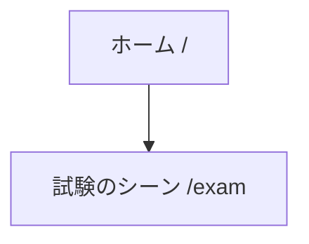

# 画面一覧と導線

アプリ（`apps/web`）の画面の一覧と、画面どうしのつながり（導線）を置く。画面ごとの課題は [画面ごとの課題](issues.md) に置く。

- **まだ無い画面** — パスを書かず、図では点線の枠にする
- **正の置き場所** — ルート（パス・画面名・一行の説明）の正は `apps/web/src/shared/routes/routes.ts`。このページは、まとまりと導線を読むためのもの。画面を足す・消す・リンクを変えたら、このページの表と図も直す
- **図の描き方** — ノードのラベルには、`routes.ts` と同じパスを書く（まだ無い画面はパスを書かず、点線の枠にする）。矢印は、画面の中のリンク・ボタンで移るもの
- **食い違いの検査** — 画面の一覧の表・図のノード・[画面ごとの課題](issues.md)のパスがルート定義と食い違うと、`pnpm docs:build` が止まる（`scripts/check-screens.mjs`）。図の矢印は検査しないので、画面の中のリンクを変えたら手で直す

## 導線図

## 画面の一覧（ロール別）

| ロール | 画面 | パス | できること |
|---|---|---|---|
| 共通 | ホーム | `/` | 最初の画面。冒険者登録の試験への入口になる |
| PL | 試験のシーン | `/exam` | 冒険者登録の試験のシーンで、手札を出す。GM への提案はまだできない（PL-2 は未着手。画面に「GM への提案は準備中です（仮）」と出す） |
