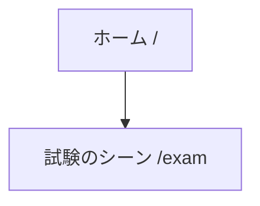

# 画面一覧と導線

アプリ（`apps/web`）の画面の一覧と、画面どうしのつながり（導線）を置く。画面ごとの課題は [画面ごとの課題](issues.md) に置く。

- **まだ無い画面** — パスを書かず、図では点線の枠にする
- **正の置き場所** — ルート（パス・画面名・一行の説明）の正は `apps/web/src/shared/routes/routes.ts`。このページは、まとまりと導線を読むためのもの。画面を足す・消す・リンクを変えたら、このページの表と図も直す
- **図の描き方** — ノードのラベルには、`routes.ts` と同じパスを書く（まだ無い画面はパスを書かず、点線の枠にする）。矢印は、画面の中のリンク・ボタンで移るもの
- **食い違いの検査** — 画面の一覧の表・図のノード・[画面ごとの課題](issues.md)のパスがルート定義と食い違うと、`pnpm docs:build` が止まる（`scripts/check-screens.mjs`）。図の矢印は検査しないので、画面の中のリンクを変えたら手で直す

## 導線図

## 画面の一覧（ロール別）

| ロール | 画面 | パス | できること |
|---|---|---|---|
| 共通 | ホーム | `/` | 最初の画面。冒険者登録の試験への入口になる |
| PL | 試験のシーン | `/exam` | 冒険者登録の試験のシーンで、ビートごとに手札を出す。紙面のビートは地の文と手札。会話のビートは上にそのビートに出る NPC の縦長のカード（話している人が光る）、真ん中に会話、下に手札と自分のカードを並べ、相手の台詞は「次へ」で1つずつ送る（会話の履歴の範囲は[ビートの見せ方](../cartagraph/index.md#ビートの見せ方)）。どのビートにも、手札の隣に点線の枠の「GM への提案」のカードがある（会話のビートでは台詞を読み切ってから）。押すと手札の上に入力欄（見出し「GM への提案」・複数行の欄・「やめる」「提案する」）が開き、送ると、そのビートは提案待ちになる。提案待ちの間は、手札の上に「提案待ち：提案が取り込まれるか見送られるまで、手札は出せません」とそのビートで出した提案の文が並び、手札は薄くなって押せない（提案のカードは押せる）。公開版では提案のカードを出さない（[提案](../cartagraph/index.md#提案)） |
